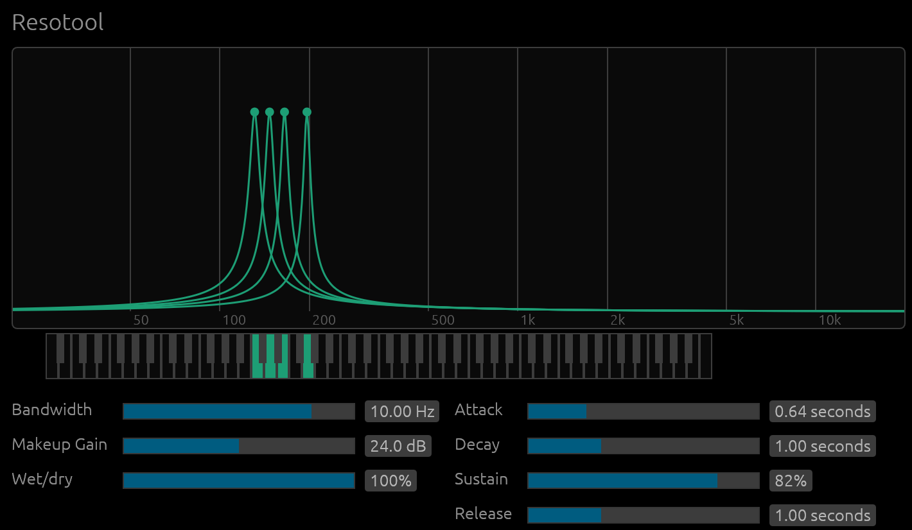

# Resotool

Resotool contains 8 MIDI-controllable resonators.
## [Download Resotool](https://github.com/buserp/resotool/releases/tag/v1.0.0)



## Building from source
After installing [Rust](https://rustup.rs/), you can compile Resotool as follows:

```shell
cargo xtask bundle resotool --release
```

The VST3 bundle is also copied to your user VST3 plugin directory, replacing any previously installed copy:
- macOS: `~/Library/Audio/Plug-Ins/VST3`
- Windows: `%LOCALAPPDATA%\Programs\Common\VST3`
- Linux: `~/.vst3`
